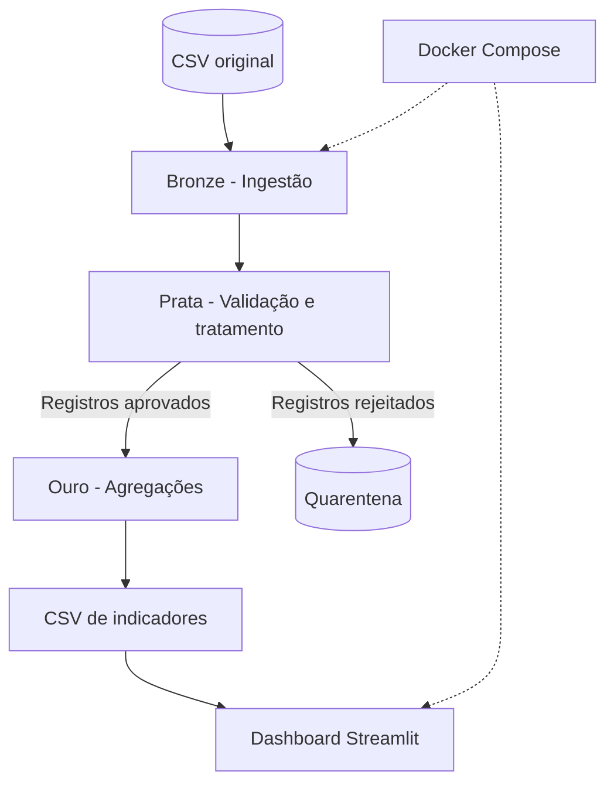

# Arquitetura do Projeto

## Visão geral

O projeto implementa um pipeline de dados baseado na arquitetura Medallion, utilizando Python e Pandas para processar os registros de acidentes rodoviários disponibilizados no desafio.

O fluxo começa com a ingestão do arquivo CSV original na camada Bronze. Em seguida, os dados passam por validações, conversões e regras de qualidade na camada Prata. Os registros aprovados seguem para a camada Ouro, onde são agregados em indicadores para análise. Os registros que não atendem às regras estabelecidas são armazenados separadamente na pasta de quarentena, acompanhados dos respectivos motivos de rejeição.

O processamento e o dashboard são executados em containers Docker, com acesso aos resultados por meio de uma interface desenvolvida em Streamlit.

## Diagrama

## Componentes

| Componente | Tecnologia | Responsabilidade |
|---|---|---|
| Ingestão (Bronze) | Python | Preservar o arquivo original e evitar duplicação da ingestão. |
| Qualidade (Prata) | Python e Pandas | Converter tipos, validar domínios, datas, coordenadas e regras de negócio. |
| Quarentena | CSV | Armazenar registros rejeitados e seus motivos. |
| Agregação (Ouro) | Python e Pandas | Gerar indicadores por mês, UF e classificação. |
| Painel | Streamlit | Apresentar KPIs e gráficos interativos. |
| Orquestração / Docker | Docker e Docker Compose | Construir as imagens, executar o pipeline e iniciar o dashboard após o processamento. |
| Testes | Pytest | Verificar funções de conversão e validação da camada Prata. |

## Organização das camadas

| Camada | Diretório | Conteúdo |
|---|---|---|
| Bronze | `lake/bronze/` | Cópia do CSV bruto. |
| Prata | `lake/silver/` | Registros aprovados e padronizados. |
| Quarentena | `lake/quarentena/` | Registros rejeitados e respectivos motivos. |
| Ouro | `lake/gold/` | Tabelas agregadas utilizadas pelo dashboard. |

Os arquivos das camadas são armazenados em CSV. A camada Prata utiliza UTF-8 e separador `;`, enquanto os arquivos de origem preservam o formato original.

## Decisões de arquitetura

| Decisão | Alternativas consideradas | Motivo da escolha |
|---|---|---|
| Formato de armazenamento | CSV ou Parquet | CSV foi escolhido pela simplicidade, facilidade de inspeção e compatibilidade com as ferramentas utilizadas. |
| Ferramenta de processamento | Python e Pandas ou Spark | Python e Pandas atendem ao volume de dados do desafio sem exigir infraestrutura distribuída. |
| Ferramenta de painel | Streamlit ou outras ferramentas de BI | Streamlit permite construir e disponibilizar um dashboard diretamente em Python. |
| Containerização | Execução local ou Docker | Docker padroniza o ambiente e facilita a reprodução da execução. |

## Idempotência e reprocessamento

A ingestão da camada Bronze verifica se o arquivo de destino já existe. Caso já tenha sido ingerido, o pipeline informa que o arquivo foi processado anteriormente e evita criar uma cópia duplicada.

As camadas Prata e Ouro são geradas novamente a partir dos dados da Bronze. Dessa forma, é possível reprocessar as validações e agregações sem modificar o arquivo original.

Essa estratégia mantém a Bronze como referência para novas execuções do processamento.

## Observabilidade

O pipeline apresenta mensagens no terminal com informações sobre cada etapa do processamento, incluindo:

- Quantidade de registros lidos na Bronze.
- Quantidade de colunas identificadas.
- Quantidade de registros aprovados na Prata.
- Quantidade de registros encaminhados para quarentena.
- Quantidade de registros processados na Ouro.

Essas informações permitem acompanhar a execução e verificar a consistência das contagens entre as camadas.

## Limitações e evoluções futuras

- Implementar logs estruturados e persistentes.
- Registrar data e hora de cada execução.
- Criar métricas históricas de qualidade dos dados.
- Implementar controle de versões dos arquivos processados.
- Avaliar formatos colunares, como Parquet, em cenários de maior volume.
- Ampliar os testes automatizados do pipeline completo.