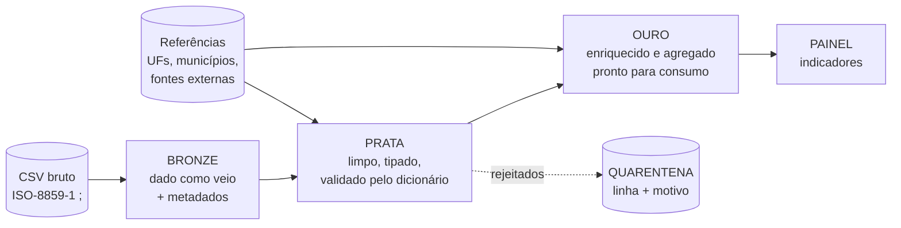

# Orientação: Arquitetura Medallion

A arquitetura medallion organiza o lago de dados em **camadas de qualidade crescente**. Cada camada tem um propósito claro e só lê da camada anterior.

## O que esperamos em cada camada

### Bronze: "o que chegou"
| Princípio | Orientação |
|---|---|
| Fidelidade | Guarde os dados **exatamente como vieram**. Não corrija, não converta tipos, não descarte linhas. |
| Rastreabilidade | Acrescente colunas técnicas: arquivo de origem, data/hora de ingestão, número da linha, hash da linha. |
| Idempotência | Rodar duas vezes não pode duplicar registros. |
| Reprocessável | Se a prata quebrar, deve ser possível refazê-la a partir da bronze, sem reler o arquivo original. |
| Atenção | Codificação do arquivo e separador são parte da ingestão. |

### Prata: "o que podemos confiar"
| Princípio | Orientação |
|---|---|
| Conformidade | Toda regra do dicionário (tipo, formato, domínio, faixa, regra de negócio) deve ser atendida. |
| Critério | Para cada problema, decida entre **corrigir**, **anular o campo** ou **rejeitar a linha**, e justifique. |
| Não inventar | Só corrija quando o valor correto puder ser deduzido com segurança (de outra coluna, de uma tabela de referência ou de uma conversão de formato). |
| Unicidade | A chave `id` deve ser única. |
| Quarentena | O que for rejeitado não some: vai para uma área própria com o **motivo**. |
| Contrato | Mesmos nomes de coluna do dicionário e `id` preservado. |

### Ouro: "o que gera valor"
| Princípio | Orientação |
|---|---|
| Orientada a perguntas | Parta de perguntas de negócio e modele tabelas que as respondam rápido. |
| Enriquecimento | Combine a prata com fontes de contexto (calendário, feriados, população, clima, geografia...). **Cite a fonte e a licença** de cada dado externo. |
| Consumo | Tabelas estreitas, nomeadas com clareza, prontas para o painel (agregações, dimensões, fatos). |
| Reprodutível | O enriquecimento deve funcionar no container, sem passos manuais. Se usar internet, descreva o que acontece se ela falhar. |

## Ideias para despertar a criatividade (não é checklist)

- Calendário: feriados nacionais, fins de semana, "véspera de feriado".
- Tempo: faixas horárias, sazonalidade por mês, estação do ano.
- Geografia: região do país, densidade por município, mapa de calor.
- Severidade: índices de gravidade ponderando mortos, feridos graves e leves.
- Comparação: taxa por 100 mil habitantes (exige população, e uma fonte pública para isso).
- Qualidade como produto: um relatório que mostre quanto foi corrigido e rejeitado, por regra.

## Armazenamento e formato

Você escolhe. Parquet costuma ser uma boa escolha para prata e ouro. O importante é que o **formato seja legível** pelo avaliador (CSV ou Parquet, veja [`ENTREGA.md`](ENTREGA.md)) e que as escolhas estejam justificadas na sua documentação.

## O desenho de arquitetura que você deve entregar

Um diagrama (Mermaid, draw.io exportado em PNG, Excalidraw, etc.) que mostre:
1. A **fonte** e o fluxo pelas três camadas;
2. Os **componentes** (containers, serviços, ferramentas) e como se conectam;
3. Onde ficam **quarentena**, **referências** e **fontes externas**;
4. Como o **painel** consome a ouro.

Um diagrama honesto e simples vale mais que um complexo e impreciso.
