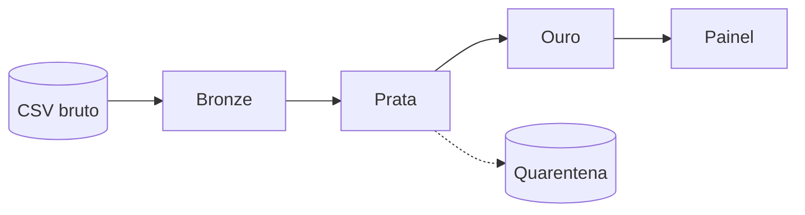

# Arquitetura

## Visão geral
<Explique em um parágrafo o fluxo de ponta a ponta.>

## Diagrama
<!-- Cole um diagrama Mermaid abaixo OU referencie uma imagem em docs/img/ -->

## Componentes
| Componente | Tecnologia | Responsabilidade |
|---|---|---|
| Ingestão (bronze) | | |
| Qualidade (prata) | | |
| Enriquecimento (ouro) | | |
| Painel | | |
| Orquestração / Docker | | |

## Decisões de arquitetura
| Decisão | Alternativas consideradas | Motivo da escolha |
|---|---|---|
| Formato de armazenamento | | |
| Ferramenta de processamento | | |
| Ferramenta de painel | | |

## Idempotência e reprocessamento
<Como a bronze evita duplicar? Como refazer a prata a partir da bronze?>

## Observabilidade (opcional)
<Logs, contagens por etapa, métricas de qualidade, alertas.>
